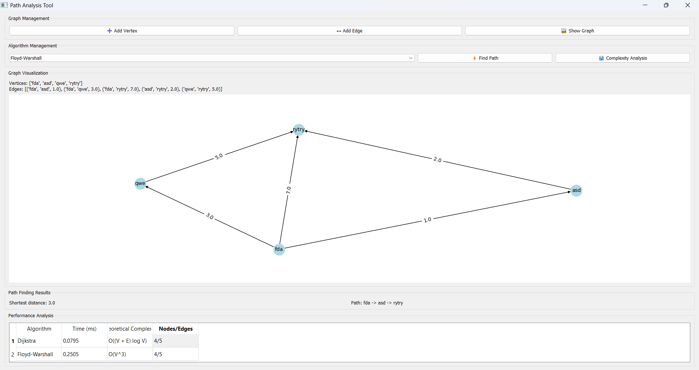

# 📈 Graph Path Analysis Tool

A desktop application for building weighted directed graphs and comparing shortest path algorithms on them. The algorithms are implemented from scratch in Python and benchmarked side by side, which makes the tool useful for studying how their theoretical complexity relates to actual running time.

<p align="center">
  
</p>

---

## Table of Contents

- [Features](#features)
- [Algorithms](#algorithms)
- [Tech Stack](#tech-stack)
- [Getting Started](#getting-started)
- [Usage](#usage)
- [Project Structure](#project-structure)
- [Limitations & Future Work](#limitations--future-work)

---

## Features

- **Interactive graph editor** — add vertices and directed weighted edges through dialogs.
- **Graph visualization** — renders the current graph with edge weights using NetworkX and Matplotlib.
- **Shortest path search** — run any of the implemented algorithms between two chosen vertices.
- **Negative weights** — supported by the algorithms that allow them, with negative cycle detection.
- **Performance benchmarking** — run all algorithms on the same graph and compare execution time against theoretical complexity.

---

## Algorithms

All algorithms are implemented manually; NetworkX is used only for storing and drawing the graph.

| Algorithm | Problem | Negative weights | Time complexity | Space |
|---|---|---|---|---|
| Dijkstra | Single-source | No | O((V + E) log V) | O(V) |
| Bellman–Ford | Single-source | Yes, detects negative cycles | O(V · E) | O(V) |
| Levit | Single-source | Yes | O(V · E) on average | O(V) |
| Floyd–Warshall | All pairs | Yes | O(V³) | O(V²) |
| Johnson | All pairs | Yes, detects negative cycles | O(V² log V + V · E) | O(V²) |
| Yen's k-shortest paths | k loopless paths | No | O(k · V · (E + V log V)) | O(V) |

**Implementation notes**

- **Dijkstra** uses a binary heap (`heapq`).
- **Bellman–Ford** relaxes all edges V − 1 times and performs an extra pass to detect negative cycles.
- **Levit** maintains two queues to re-process vertices whose distances were updated, which often makes it faster than Bellman–Ford in practice.
- **Johnson** reweights edges using potentials from Bellman–Ford, then runs Dijkstra on the reweighted graph.

---

## Tech Stack

- **Python 3.8+**
- **PyQt5** — desktop GUI
- **NetworkX** — graph storage and layout
- **Matplotlib** — graph rendering embedded in the Qt window

---

## Getting Started

```bash
git clone https://github.com/nleaxy/GraphPathAnalysis.git
cd GraphPathAnalysis
pip install -r requirements.txt
python code.py
```

---

## Usage

**1. Build a graph**
- **Add Vertex** — enter a vertex name.
- **Add Edge** — choose the source and target vertices and enter a weight (from −1000 to 1000).
- **Show Graph** — draw the current graph.

**2. Find a shortest path**
- Select an algorithm from the drop-down list and click **Find Path**.
- Choose the start and end vertices. The distance, the path and the execution time are shown in the results section.

**3. Compare performance**
- Click **Complexity Analysis** to run every algorithm on the current graph.
- The table shows execution time in milliseconds, theoretical complexity and graph size (V/E).

### Example

```
Vertices: A, B, C, D
Edges:    A→B (5), B→C (3), A→C (9), C→D (2)

Algorithm: Dijkstra, from A to D
Result:    distance = 10, path = A → B → C → D
```

The direct edge A→C (9) is longer than the route through B (5 + 3 = 8), so the algorithm picks the path via B.

---

## Project Structure

```
GraphPathAnalysis/
├── code.py           # Application: GUI and algorithm implementations
├── requirements.txt  # Pinned dependencies
└── example1.png      # Screenshot
```

---

## Limitations & Future Work

- **Yen's algorithm** currently returns only the single shortest path (k = 1, computed with Dijkstra). A full k-shortest-paths implementation is planned.
- Graphs are built manually; importing from a file (edge list or adjacency matrix) and random graph generation would make large-scale benchmarking easier.
- Timing is measured on a single run; averaging over several runs would give more stable results.
